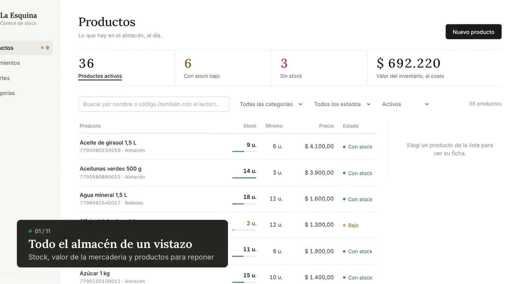

# Control de stock

Sistema de control de stock para almacenes y kioscos. Muestra en todo momento qué mercadería hay, qué se está terminando, qué se vende más y cuánto deja cada venta. Es una aplicación de escritorio que funciona sin internet.



[Ver el video de la demo en mi portafolio](https://sergio-cardozo.vercel.app/#p-stock)

## Qué hace

- Productos con código de barras, categoría, costo y porcentaje de ganancia: el precio de venta se calcula solo.
- Alertas de stock bajo y sin stock, con el valor total de la mercadería al costo.
- Compras, ventas, mermas, devoluciones y conteos, cada uno en un historial con el saldo. Los movimientos se anulan en lugar de borrarse.
- Venta por peso para fiambres y productos sueltos, al gramo.
- Reportes de lo más vendido, la ganancia por categoría y la mercadería parada.
- Lista de compras sugerida, que se manda al proveedor por WhatsApp, se copia o se imprime.
- Copias de seguridad automáticas todos los días.

## Aspectos técnicos

- **Stock que se puede auditar:** no se guarda como un número suelto, se calcula a partir de todos los movimientos.
- **Sin errores de redondeo:** el dinero y las cantidades se guardan como enteros, incluso en las ventas al gramo.
- **Actualizaciones seguras:** la base de datos se actualiza sola con migraciones y la ventana está aislada del sistema.

## Tecnologías

Electron · JavaScript · HTML · CSS · SQLite con better-sqlite3 · node:test

## Cómo ejecutarlo

Necesitás [Node.js](https://nodejs.org) en su versión LTS.

```bash
npm install
npm start      # abre la aplicación en modo desarrollo
npm test       # corre las pruebas automatizadas
npm run make   # genera el instalador (en Windows, el .exe)
```

La carpeta `datos-prueba` tiene scripts SQL con datos de ejemplo. Cada uno explica al principio cómo cargarlo.

## Estructura

```
src/
  index.js     proceso principal de Electron
  preload.js   puente seguro entre la ventana y el proceso principal
  db/          acceso a SQLite, migraciones y copias de seguridad
  ui/          pantallas de la aplicación (HTML, CSS y JavaScript)
pruebas/       pruebas automatizadas con node:test
datos-prueba/  scripts SQL con datos de ejemplo
```

## Autor

**Sergio Cardozo**, desarrollador full stack en Formosa, Argentina.
[Portafolio](https://sergio-cardozo.vercel.app) · [LinkedIn](https://www.linkedin.com/in/sergiocardozo-dev) · [GitHub](https://github.com/Gabicrdz)
